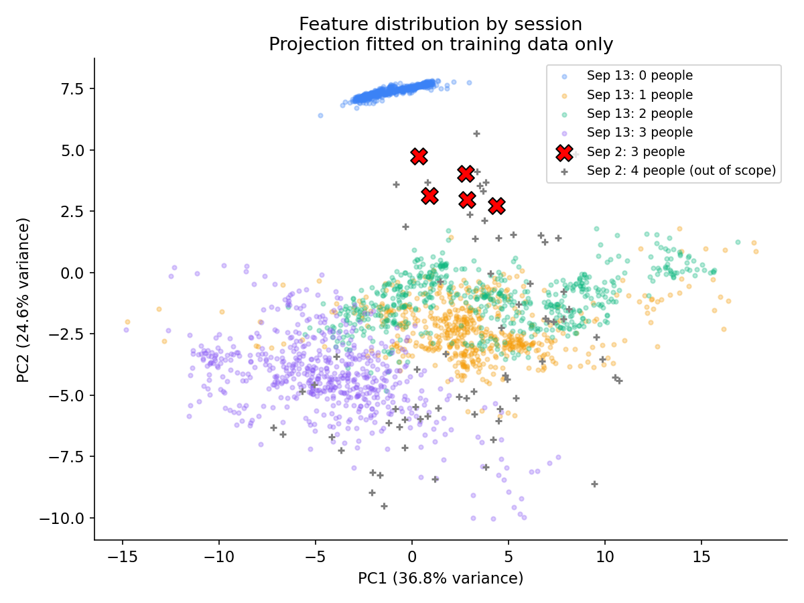

# 0~3명 CSI 데이터 구분 가능성과 9월 2일 데이터 혼합 학습 분석

분석일: 2026-09-14. 비교 날짜는 사용자 확인에 따라 **2026-09-02와 2026-09-13**이다.

**판정: 9월 13일에 수집한 네 인원수 데이터는 실제로 구분된다. 빈 방은 특히 뚜렷하고, 1명과 2명은 일부 겹친다. 다른 날짜·배치의 데이터도 학습에 사용할 수 있지만, 현재 두 날짜 데이터를 단순히 합쳤다는 이유만으로 환경 변화에 강해졌다고 판단할 수는 없다.**

실제 CSI 수치를 사용해 최근접 중심, 로지스틱 회귀, SVM, RandomForest를 학습·실행했다. GPT가 그래프를 보고 인원수를 추측한 결과가 아니다. 저장한 모델을 별도 프로세스에서 다시 불러와, 정답·날짜·파일명·시각이 없는 CSI 특징 658개 구간을 재판별했다.

## 1. 현재 데이터는 얼마나 구분되는가

9월 13일 정상 세션은 0·1·2·3명 각각 20분씩이다. 2초 구간을 서로 겹치지 않게 사용하고, 시작과 끝 30초를 제외했다. 각 세션의 30~780초로 학습하고, **60초를 비운 뒤 840~1170초를 시험**했다. 품질 점검 후 학습 1,488개, 시험 658개 구간이 남았다. 결과의 단위는 사람 수를 출력한 **2초 구간**이다.

| 시험 방법 / 모델 | 정확도 | 의미 |
|---|---:|---|
| CSI 진폭 특징 82개 + RandomForest | **88.0% (579/658)** | 현재 데이터의 기본적인 구분 가능성 확인 |
| CSI 진폭 특징 82개 + SVM | **90.7% (597/658)** | 같은 입력의 다른 분류기에서도 구분 |
| 진폭 크기를 정규화한 특징 76개 + SVM | **96.2% (633/658)** | 이번 탐색 실험에서 가장 좋은 후보 |
| 정규화 SVM: 뒷부분 학습 → 앞부분 시험 | **93.3% (611/655)** | 시간 방향을 바꿔도 구분 신호 유지 |
| 정규화 SVM: 5개 시간 블록을 번갈아 제외 | **90.3~100.0%** | 블록마다 성능 차이가 있으며 평균 약 96.0% |
| 겹치는 구간을 무작위로 나눈 RandomForest | **99.6%** | 시험 구간의 92.1%가 학습 구간과 원시 패킷을 공유하므로 성능 근거로 사용하지 않음 |

여기서 정규화는 안테나·부반송파별 진폭 특징을 **해당 2초 구간의 평균 진폭으로 나누고**, 학습 데이터로 계산한 평균·표준편차를 적용하는 방법이다. 시험 세션 전체의 통계나 정답은 사용하지 않았다. 상대적인 신호 패턴을 강조하는 간단한 전처리이며, 환경 영향을 완전히 없애는 방법은 아니다.

| 실제 인원수 | 기본 RandomForest에서 맞힌 비율 | 정규화 SVM에서 맞힌 비율 | 해석 |
|---|---:|---:|---|
| 0명 | 100.0% (164/164) | **100.0% (164/164)** | 빈 방이 매우 잘 분리됨 |
| 1명 | 80.5% (132/164) | **88.4% (145/164)** | 주로 2명과 혼동 |
| 2명 | 86.7% (143/165) | **98.8% (163/165)** | 정규화 후 구분 개선 |
| 3명 | 84.8% (140/165) | **97.6% (161/165)** | 정규화 후 구분 개선 |

정규화 SVM의 전체 macro F1은 **0.9622**, 기본 RandomForest는 **0.8824**다. 표의 인원별 비율은 실제 해당 인원수인 구간을 맞힌 비율, 즉 재현율이다.

정규화 SVM의 혼동행렬은 다음과 같다. 행은 실제 인원수, 열은 예측 인원수다.

| 실제 / 예측 | 0명 | 1명 | 2명 | 3명 |
|---|---:|---:|---:|---:|
| 0명 | 164 | 0 | 0 | 0 |
| 1명 | 0 | 145 | 19 | 0 |
| 2명 | 0 | 0 | 163 | 2 |
| 3명 | 0 | 0 | 4 | 161 |

기본 RandomForest를 인원수 두 종류씩 따로 학습한 경우에도 0명 대 1명, 0명 대 2명, 0명 대 3명은 모두 이번 시험 구간에서 100%였다. 1명 대 2명은 83.3%, 1명 대 3명은 97.0%, 2명 대 3명은 90.0%였다. 두 종류만 분류한 수치를 네 종류 분류 성능과 동일하게 해석해서는 안 된다.

**따라서 현재 데이터는 “차이가 없어 학습이 불가능한 데이터”가 아니다. 인원수 분류 프로토타입을 만들 수 있는 신호가 실제로 있다.** 다만 최고 후보는 여러 모델을 비교한 탐색 결과이며, 새로 수집한 세션에서의 확정 성능은 아니다.

## 2. 9월 2일과 9월 13일은 얼마나 다른가

| 날짜 | 인원수 | 정상 CSI 레코드 수 | 원시 CSI의 관측 시간 | 이번 분석에서의 용도 |
|---|---:|---:|---:|---|
| 9월 13일 | 0명 | 101,194 | 1,200.54초 | 0~3명 분류 |
| 9월 13일 | 1명 | 101,474 | 1,200.05초 | 0~3명 분류 |
| 9월 13일 | 2명 | 103,856 | 1,200.31초 | 0~3명 분류 |
| 9월 13일 | 3명 | 103,326 | 1,200.10초 | 0~3명 분류 |
| 9월 2일 | 3명 | 914 | 12.48초 | 같은 인원수의 날짜 비교; 송신 계획은 10초 |
| 9월 2일 | 4명 | 96,614 | 1,202.76초 | 목표 범위 밖 입력 점검 |

두 날짜는 Intel 5300 수신기, 채널 6 / 2,437 MHz, 같은 핫스팟 BSSID, 주된 CSI 차원 3 RX × 2 TX, 30개 부반송파 그룹, 100 UDP 패킷/초 조건을 공유한다. 원시 파일 형식과 기존 전처리 설정도 같다. **다른 날이라는 이유로 파일 형식이 맞지 않아 혼합 학습이 불가능한 상황은 아니다.**

실제 무선 송신 지점은 휴대폰 핫스팟/AP다. 송신 PC는 트래픽 생성기이므로, 위치 고정과 기록에서는 **AP ↔ 수신기** 사이 배치가 중요하다. 3×2는 안테나/송신 스트림 차원이며 사람 수가 아니다.

하지만 같은 3명끼리 비교해도 신호 분포는 달랐다. 아래 값은 품질 조건을 통과한 비중복 2초 구간의 평균이며, 9월 2일은 5개 구간뿐이다.

| 특징 | 9월 2일 3명 | 9월 13일 3명 | 관찰 |
|---|---:|---:|---|
| 스케일 보정 CSI 평균 진폭 | 19.264 | 16.583 | 이전 데이터가 약 16.2% 큼 |
| 구간 내 CSI 진폭 표준편차 | 11.794 | 8.239 | 이전 데이터가 약 43.1% 큼 |
| 연속 패킷 평균 진폭의 절대 변화량 | 0.794 | 0.560 | 이전 데이터의 변화량이 더 큼 |
| 총 수신 신호 세기 | -28.956 dBm | -29.056 dBm | 약 0.1 dB 차이로 비슷함 |

표준편차 특징은 안테나·부반송파·시간 방향의 값이 함께 포함되므로, 사람 움직임만의 크기로 해석하지 않았다. 총 수신 세기가 비슷해도 여러 경로로 반사된 CSI 패턴은 다를 수 있다.

**9월 13일 전체 적격 구간으로만 학습하고, 9월 2일 3명 구간을 처음 입력한 결과:**

| 모델 | 9월 2일의 실제 3명 구간 5개에 대한 결과 |
|---|---|
| CSI 진폭 RandomForest | 5개 모두 2명으로 예측 |
| CSI 진폭 SVM | 5개 모두 1명으로 예측 |
| 정규화 특징 RandomForest | 2개는 0명, 3개는 2명으로 예측 |
| 정규화 특징 SVM | **5개 모두 3명으로 예측** |

**분포 차이는 확인됐고, 결과는 전처리와 분류기에 크게 의존했다.** 정규화 SVM은 활용 가능성을 보여줬지만, 5개 구간은 단 한 번의 약 10초 실험에서 나온 값이다. 이를 “다른 날에도 100% 맞힌다”거나 “책상 배치 변화가 해결됐다”는 증거로 쓰면 안 된다. 기본 모델의 실패도 책상 이동 하나만의 효과라고 단정할 수 없다. 날짜, 사람 위치·자세·활동, 장비 위치, 무선 상태가 함께 달라졌을 가능성이 있다.

사용자는 책상 배치의 일부 변경을 확인했다. 영상 표본에서도 날짜 간 시야와 공간 사용이 다르고, 어제의 인원별 세션에서도 빈백·의자 상태와 사람 위치·자세·활동이 달랐다. 영상만으로 AP/수신기의 정확한 이동 거리까지 확인할 수는 없으며, 해당 위치는 메타데이터에 unknown으로 남아 있다.



그림은 82개 특징을 두 축으로 요약한 것으로, 빈 방의 분리와 날짜별 패턴 차이를 보여준다. 두 축에 겹쳐 보인다고 전체 특징 공간에서도 구분이 불가능하다는 뜻은 아니다.

## 3. 두 날짜 데이터를 섞어 학습해도 되는가

**사용해도 된다. 다만 인원 라벨을 유지하고, 날짜·방 배치를 별도의 수집 조건으로 관리하면서 섞어야 한다.** 서로 다른 환경의 데이터는 앞으로 다양한 배치에서 동작하는 모델을 만드는 데 필요하다. 현재처럼 환경별로 인원 종류가 빠진 상태에서는 환경 특징과 인원수 특징을 혼동할 위험이 있다.

이번에는 9월 13일 학습 구간에 9월 2일의 적격 3명 구간 5개를 실제로 추가했다. 시험 구간은 기존 9월 13일의 658개로 고정했다.

| 같은 시험 구간에 대한 결과 | 9월 13일만 학습 | 9월 2일 3명도 추가 |
|---|---:|---:|
| CSI 진폭 RandomForest | 88.0% (579/658) | 88.0% (579/658) |
| 정규화 특징 SVM | 96.20% (633/658) | 96.35% (634/658) |

이 작은 추가 실험에서는 크게 나빠지지 않았고, SVM은 한 구간 더 맞혔다. **한 구간 차이를 의미 있는 성능 향상으로 주장할 수는 없다.** 오래된 배치에서의 새로운 독립 시험 세션도 없으므로, 혼합 학습의 일반적인 이득은 아직 확인하지 못했다. 날짜별 자료량 차이도 매우 크다.

현재 파일을 사용하는 기준은 다음과 같다.

- **9월 2일 3명:** 원본을 보존하고, 배치/날짜를 구분한 보조 학습 또는 외부 시험 자료로 활용한다. 동일 실험에서 학습에도 넣고 날짜 간 일반화 시험에도 다시 쓰지 않는다.
- **9월 2일 4명:** 0~3명 모델에는 학습 정답으로 합치지 않는다. 4명은 목표 범위 밖이다. 0~4명으로 확장하려면 4명 클래스를 명시적으로 추가하고, 9월 13일 배치에서도 4명을 수집해야 한다.
- **실패 표시된 9월 13일 2명 두 세션:** 이번 학습에서 제외했다. 원시 프레임은 읽혔지만 완료되지 않았고 라벨 상태가 unknown이다. 영상으로 안정된 2명 구간을 검수하면 일부를 복구할 여지는 있다.

0~3명만 학습한 분류기는 4명이 들어와도 네 가지 중 하나를 출력한다. 실제 이전 4명 자료를 넣었을 때도 주로 2명 또는 3명으로 강제 분류했다. “4명인지 모른다”는 감지 기능까지 만든 것은 아니다.

## 4. 앞으로 무엇을 보완해서 수집할 것인가

**최우선은 긴 파일 하나를 늘리는 것보다, 같은 인원수의 독립 반복 실험을 늘리는 것이다.** 현재의 각 20분 파일은 모델에 많은 2초 구간을 주지만, 독립된 방 배치·사람 배치 사례는 하나에 가깝다.

- 같은 유효 수집 시간 80분을 쓴다면 **0~3명 각각 5분 × 4회**로 나누는 방식을 출발점으로 권한다. 준비·이동 시간은 별도다. 순서는 매 반복에서 바꿔 시간 경과와 인원수가 연결되지 않게 한다.
- **각 방 배치에서 0·1·2·3명을 모두 수집**한다. 배치 A에 0~2명만 있고 배치 B에 3명만 있는 구성을 피한다. 최소 여러 날짜에 반복해 날짜 하나를 통째로 시험용으로 남길 수 있게 한다. 3일 이상은 현실적인 시작 제안이며 필요한 데이터량을 보장하는 규칙은 아니다.
- 먼저 AP/수신기/안테나와 책상·빈백·의자를 고정하고 인원수만 바꿔 수집한다. 그 다음 별도 실험에서 배치와 사람 위치·자세·활동을 바꾼다. 1명은 앉기만 하고 3명은 걷기만 하는 식으로 활동이 정답을 대신하지 않게 한다.
- 사람이 없는 방의 기준 CSI를 **각 날짜·배치에서** 시작과 끝에 확보한다. 해당 방의 기준이 달라졌는지 비교하는 데 사용한다. 향후 빈 방 기준으로 보정한다면, 실제 운용에서도 그 보정 자료를 얻을 수 있는 조건으로 평가해야 한다.
- `date`, `layout_id`, `session_id`, 인원수, 사람 위치·활동, AP/수신기 좌표·높이·거리·방향, 문 상태를 기록한다. 실제 AP 위치와 수신 안테나 방향을 사진/배치도와 함께 남긴다.
- 학습/시험은 **원래 세션 또는 날짜를 먼저 분리한 후** 시간 구간을 만든다. 서로 겹치는 2초 구간을 양쪽에 흩뿌리지 않는다. 같은 세션의 구간은 연관되므로 세션 기반 검증이 필요하다. [scikit-learn의 그룹 교차검증 설명](https://scikit-learn.org/stable/modules/cross_validation.html#cross-validation-iterators-for-grouped-data)

이 프로토콜로 반복한 후 “어제 자료만 학습”, “여러 배치 혼합 학습”을 **같은 미사용 날짜·세션**에 평가하면, 혼합 학습이 도움이 되는지 판단할 수 있다. 전체 정확도뿐 아니라 특히 1명↔2명 혼동과 인원별 재현율을 확인해야 한다.

## 5. 파일 품질과 수집 코드에서 확인한 사항

정상 0~3명 자료에는 총 **409,850개** CSI 레코드가 있다. 파일 전체 프레임 경계·헤더·안테나 차원·길이를 검사했고, 샘플 복소 CSI 디코딩 및 기존 특징 파일의 원시 파일 SHA-256 일치를 확인했다. 전체 8개 원시 파일에서 구조 오류는 발견하지 못했다. 모든 복소 CSI 행렬을 새로 전부 계산한 것은 아니며, 이번 학습은 해시가 일치하는 기존 특징 파일을 사용했다.

- **수집률:** 9월 13일 정상 세션의 관측 CSI는 약 84.3~86.5개/초였다. 목표 UDP는 100개/초이며 수신 UDP 수도 약 12만 개였다. CSI/UDP 비율은 약 84~87%지만, 두 기록이 반드시 1:1 대응하는 것은 아니므로 이를 그대로 무선 패킷 손실률이라고 부르지 않는다.
- **짧은 빈 구간:** 정상 9월 13일 자료의 최대 패킷 간격은 0.29~0.44초, 이전 4명 자료는 2.71초였다. 이번에는 2초당 80패킷 이상, 관측 폭 1.5초 이상, 최대 간격 0.2초 이하인 구간을 사용했다. 시간 역전이 포함된 구간도 제외했다. 이 기준은 이번 분석용이며 보편적 하드웨어 합격 기준은 아니다.
- **소수의 차원 변경:** 9월 13일 정상 자료에서 3×1 레코드 36개, 전체의 약 0.0088%가 있었다. 기존 전처리는 이 패킷들을 건너뛰고 주된 3×2 CSI로 특징을 계산했다. 하지만 manifest는 한 개만 있어도 `needs_review`, `final_training_allowed=false`가 되므로 네 세션 모두 최종 학습 불가로 표시돼 있다. 이번에는 검토한 실험 자료로 사용했다. 원본 품질 플래그는 변경하지 않았다. 앞으로는 제거 패킷 비율과 구간 품질을 따로 기록해 검수된 구간을 사용할 수 있도록 보완하는 편이 좋다.
- **타임스탬프 역전:** 1명과 2명 파일에서 각각 두 번, 약 0.37~3.53ms의 작은 역전이 있었다. 해당 구간을 제외했다. 실시간 전처리에서는 정렬 또는 역전 패킷 처리 규칙을 명시해야 한다.
- **실제 시각 오류:** 9월 13일 `meta.json`의 시작 시각은 실제 logger 시작보다 **약 1,249초, 즉 20분 49초 늦다.** `create_meta.py`의 세션 이름 해석이 끝의 임의 식별자를 처리하지 못해 메타데이터 생성 시각을 시작 시각으로 사용하는 것이 원인이다. 단순히 이름 정규식만 고쳐도 GUI를 연 시각과 실제 수집 시각은 다르므로, `capture_runtime.json`의 실제 logger/패킷 시각을 기록하도록 수정해야 한다. 이번 CSI 분류는 NIC의 상대 시각과 세션 라벨을 써 이 잘못된 절대 시각을 사용하지 않았다.
- **영상 동기화:** 정상 세션 영상은 모두 WebM/VP8로 열리고 탐색 가능했다. 긴 영상은 35·305·605·905·1,175초, 짧은 3명 영상은 6·11·18초 표본을 확인했다. 빈 방 표본에는 사람이 보이지 않았고, 나머지는 시야 가장자리/가림이 있지만 세션 라벨과 대체로 부합했다. 전 프레임 라벨 검수는 하지 않았다. 프로세스 시작 시각과 실제 첫 영상 프레임 시각은 같지 않을 수 있어 정밀 동기화가 필요하다.
- **절전 상태:** 9월 13일 3명 및 실패한 2명 세션에는 송신 PC의 절전 on 기록이 있고, 나머지 정상 세션은 off였다. 조건을 통일하고 기록할 필요는 있지만, 이 정보만으로 수집 실패나 분류 차이의 원인을 절전으로 단정하지 않았다.
- **기존 평가 코드의 주의점:** `train_baseline.py`는 독립 시험 세션이 없으면 학습 자료 자체의 정확도를 출력한다. 그 숫자를 새로운 데이터에서의 성능으로 쓰면 안 된다. 이번 별도 분석 스크립트는 학습·시험을 명시적으로 분리하고 구간이 겹치지 않는지 검사했다.

## 6. 모델을 만들어야 하는가, Codex GPT로 계속해도 되는가

**Codex로 개발·분석을 계속하면 된다. 동시에 실제 CSI 분류 모델 파일은 필요하며, 이번에 이미 만들었다.** 둘은 역할이 다르다.

- Codex: 수집 파일 검사, 특징 추출 코드 작성, 모델 학습/평가 실행, 결과 해석, 수집 방법 개선을 돕는다. 공식 문서도 로컬 파일을 살펴보고 코드를 수정·실행하는 도구로 설명한다. [OpenAI 공식 Codex CLI 문서](https://learn.chatgpt.com/docs/codex/cli)
- 사람 수 분류 모델: 새로운 2초 CSI 특징을 받아 0·1·2·3 중 하나를 일관된 수치 계산으로 출력한다. 학습된 SVM/RandomForest와 전처리 규칙을 파일로 저장해 재사용한다.

사용자가 학습 코드를 혼자 작성할 필요는 없다. Codex에게 추가 데이터로 재학습과 검증을 계속 맡길 수 있다. 다만 논문의 실험 결과와 실제 작동 시스템은 **저장된 분류기, 동일한 전처리, 분리된 평가 데이터**를 기준으로 해야 한다. 매번 GPT의 설명만으로 인원수를 판단하는 방식은 이번에 검증한 시스템이 아니다.

현재 규모에서는 정규화 + SVM 같은 작은 모델로 계속 개발할 근거가 있다. CNN/LSTM이나 GPT 자체의 추가 학습부터 시작할 필요는 없다. 오늘 만든 것은 저장된 CSV에 대한 오프라인 프로토타입이며, 연속 수신 → 전처리 → 인원수 화면 표시까지의 실시간 앱은 이번 범위에서 구축하지 않았다.

프로젝트 PDF의 주요 참고 논문인 Person-in-WiFi는 사람 수 분류보다 세밀한 몸 분할·자세 추정을 다루며, 안테나 구성도 다르다. 이번 실험은 프로젝트 문서에서 단순화한 0~3명 분류 가능성을 검사한 것으로, 원 논문의 모델 구조나 성능을 재현한 결과가 아니다. [Person-in-WiFi, ICCV 2019](https://openaccess.thecvf.com/content_ICCV_2019/html/Wang_Person-in-WiFi_Fine-Grained_Person_Perception_Using_WiFi_ICCV_2019_paper.html)

별도의 사람 수 연구에서도 CSI의 통계 특징과 학습 모델로 인원수를 추정하는 접근을 사용한다. 그 연구의 다중 장비·움직이는 사람 조건과 본 실험 조건은 다르므로 논문 정확도를 본 데이터의 기대 정확도로 가져오지 않았다. [People Counting by Dense WiFi MIMO Networks, 2019](https://pmc.ncbi.nlm.nih.gov/articles/PMC6721073/)

## 7. 저장된 결과와 재실행

- 전체 실험 수치: [metrics.json](../outputs/people_count_analysis_20260914/metrics.json)
- 모델별 요약표: [metrics_summary.csv](../outputs/people_count_analysis_20260914/metrics_summary.csv)
- 원시 파일·메타데이터 점검: [session_audit.json](../outputs/people_count_analysis_20260914/session_audit.json)
- 정확한 학습/시험 구간: [split_manifest.csv](../outputs/people_count_analysis_20260914/split_manifest.csv)
- 각 구간의 실제 정답과 예측: [predictions.csv](../outputs/people_count_analysis_20260914/predictions.csv)
- 정규화 SVM: [people_count_normalized_svm_prototype.joblib](../outputs/people_count_analysis_20260914/people_count_normalized_svm_prototype.joblib)
- 기본 RandomForest: [people_count_rf_prototype.joblib](../outputs/people_count_analysis_20260914/people_count_rf_prototype.joblib)
- 외부 패키지 없이 실행 가능한 기본 중심 모델: [people_count_centroid_prototype.json](../outputs/people_count_analysis_20260914/people_count_centroid_prototype.json)
- 분석 코드: [analyze_people_separability.py](../scripts/evaluate/analyze_people_separability.py)
- 저장 모델 실행 코드: [predict_people_prototype.py](../scripts/evaluate/predict_people_prototype.py)

프로젝트 디렉터리에서 전체 분석을 다시 실행한다.

```bash
python3 scripts/evaluate/analyze_people_separability.py
```

저장된 정규화 SVM으로 CSI 특징을 판별한다. 아래 입력은 날짜·파일명·정답을 제거한 시험 구간이다.

```bash
python3 scripts/evaluate/predict_people_prototype.py \
  --features-csv outputs/people_count_analysis_20260914/heldout_csi_only.csv \
  --model outputs/people_count_analysis_20260914/people_count_normalized_svm_prototype.joblib \
  --out-csv outputs/people_count_analysis_20260914/reloaded_svm_predictions.csv
```

분석 패키지는 `outputs/csi_analysis_env`에 별도로 설치했다. 수집용 커널·드라이버·원시 데이터·기존 수집 설정은 변경하지 않았다. Python 3.6.9, NumPy 1.19.5, SciPy 1.5.4, scikit-learn 0.24.2를 사용했고 랜덤 시드는 20260914로 고정했다. 모델 파일은 연구용 0~3명 후보이며, 새로운 세션/배치에서의 검증과 범위 밖 입력 처리 기능은 별도로 필요하다.
